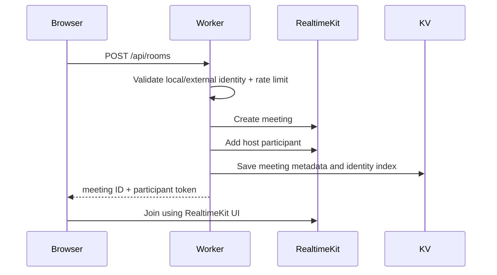
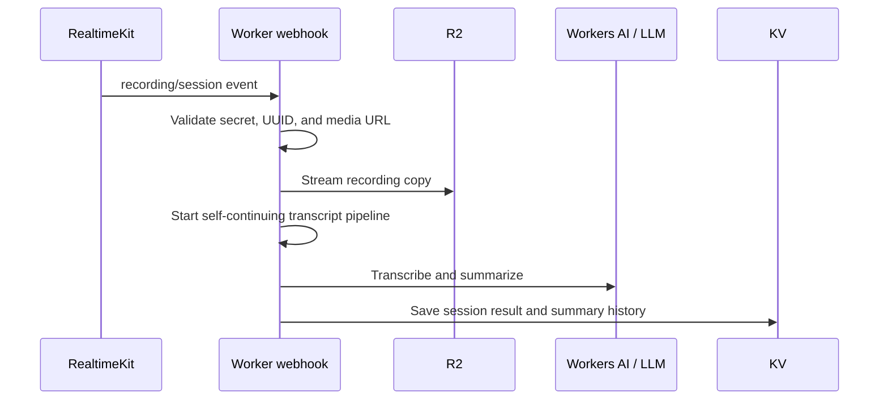

# Architecture

VE Rooom is a full-stack Cloudflare Worker. Static Assets serves the React application, while `worker/index.ts` dispatches `/api/*` requests to handlers in `functions/api/`.

## System context

```text
┌────────────────────── Browser ──────────────────────┐
│ React SPA · local pseudonymous identity · WebRTC UI │
└───────────────────────┬─────────────────────────────┘
                        │ HTTPS / WebRTC
                        ▼
┌──────────────── Cloudflare network ─────────────────┐
│ Worker                                                │
│  ├─ Static Assets: React/Vite bundle                  │
│  ├─ API router: worker/index.ts                       │
│  └─ API modules: functions/api/**                     │
│                                                       │
│ RealtimeKit ─ SFU, meetings, sessions, recordings    │
│ Workers AI  ─ Whisper + Llama                         │
│ KV          ─ metadata and derived meeting state      │
│ R2          ─ durable recording bytes                 │
└───────────────┬───────────────────────────────────────┘
                │ optional HTTPS
                ▼
       LLM providers · email provider · external auth
```

No origin VM or long-running server is required in the request path.

## Frontend routes

| Route | Purpose |
|---|---|
| `/` | Create or join a meeting |
| `/dashboard` | Meetings associated with the current local/external identity |
| `/meeting/:roomId` | RealtimeKit meeting UI |
| `/summary/:roomId` | Transcript, summary, history, and recording downloads |

## API routes

The authoritative route table is [`worker/index.ts`](../worker/index.ts).

| Method | Path | Purpose |
|---|---|---|
| POST | `/api/rooms` | Create meeting and host participant |
| POST | `/api/rooms/:id/participants` | Join meeting |
| GET | `/api/meetings` | List meetings for the current identity |
| POST | `/api/recordings/start` | Deduplicated composite recording start |
| POST | `/api/recordings/stop` | Stop active meeting recordings |
| GET | `/api/summary/:id` | Resolve session transcript, summary, and recordings |
| POST | `/api/generate-summary` | Generate or regenerate a summary |
| POST | `/api/transcribe` | Transcribe an allowlisted audio URL |
| POST | `/api/transcribe-continue` | Continue long post-meeting work in a fresh request |
| POST | `/api/webhook` | Process RealtimeKit events |
| GET/POST | `/api/prompt` | Current identity's default prompt |
| GET/POST | `/api/prompt/:id` | Meeting prompt |
| GET | `/api/recent-data` | Recent meeting status |
| POST | `/api/recording/scan` | Reconcile recording references |
| GET | `/api/recording/:key` | Range-capable R2 proxy |
| POST | `/api/send-summary-email` | Send a cached summary |

Every endpoint is rate-limited through KV. Public media-fetching endpoints additionally validate UUIDs and HTTPS media hosts.

## Meeting flow



## Post-meeting flow



Worker post-response time is finite, so long transcription work is checkpointed and continued through `/api/transcribe-continue`. Each request acknowledges quickly and schedules the next bounded unit of work.

## Data authority

- **RealtimeKit** is authoritative for meeting/session status and temporary source media.
- **R2** is authoritative for durable recording bytes.
- **KV** stores application metadata, indexes, transcripts, summaries, prompts, locks, and rate-limit counters.
- **Browser storage** stores the local pseudonymous identity and a per-tab RealtimeKit participant token.

KV recording references are treated as a cache. The application re-lists and probes R2 objects before presenting recording links.

## Identity

Fresh deployments use `guest:<uuid>` tokens created and stored in the browser. They provide stable pseudonymous ownership but not strong authentication. If `FORMSDB_URL` is configured, legacy/external PocketBase tokens are also accepted. The verification boundary is centralized in `functions/auth.ts` so a stronger provider can replace either mode later.

See [`IDENTITY.md`](IDENTITY.md).

## Security boundaries

- Cloudflare and provider API tokens are server-side Worker secrets.
- Participant tokens are short-lived and stored in `sessionStorage`.
- Media URLs must use HTTPS and match the configured allowlist.
- Recording keys are URL-encoded and resolved through the R2 binding.
- Webhooks support a shared secret and constant-time comparison.
- Local identity is deliberately documented as non-authentication; do not use it for paid credits or sensitive tenancy.

## Deployment

Cloudflare's deploy button provisions fresh bindings and connects Workers Builds to the deployer's cloned repository. Manual deploys use Wrangler 4. See [`DEPLOYMENT.md`](DEPLOYMENT.md).
